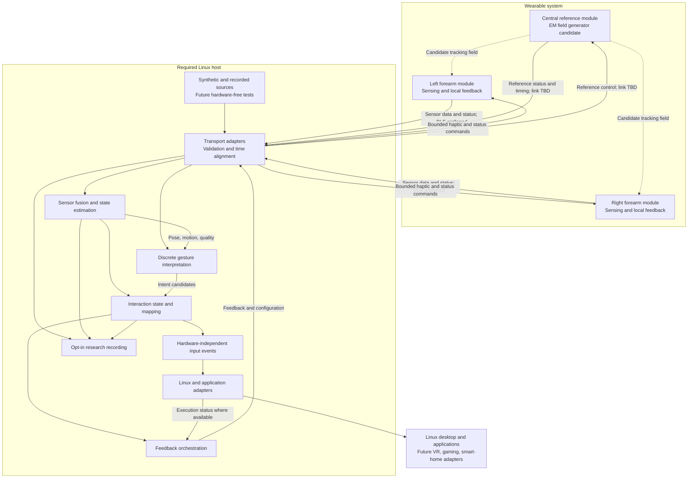

<!--
SPDX-FileCopyrightText: 2026 Vladyslav Kononiuk
SPDX-License-Identifier: CC-BY-4.0
-->

# Conceptual architecture

## Status and boundaries

This architecture describes **Kinestro — Wearable Spatial Input System**, the specific modular wearable implementation of **Cyberdirigokinesis — Natural Spatial Human–Computer Interaction**. Cyberdirigokinesis is the broader interaction paradigm of controlling digital systems through natural human movements and gestures, encompassing physical movements, spatial positioning, and gestures. Voice interaction is a separate, independent concept: voice recognition and voice command processing are outside Cyberdirigokinesis and are not Kinestro requirements or core subsystems. Any future interoperability with voice-controlled systems is an optional external integration.

The established system boundary is two forearm modules, one central wearable reference module, and a required Linux host ([ADR-0001](adr/0001-linux-host-and-module-boundaries.md)). Initial tracking is body-relative and requires no room infrastructure ([ADR-0002](adr/0002-body-relative-tracking.md)). Interfaces below are conceptual proposals, not a selected wire protocol, process layout, or implementation language.

The approved [licensing policy](../LICENSE.md) separates project software/firmware (MPL-2.0), original hardware design sources (CERN-OHL-W-2.0), and documentation (CC-BY-4.0). Future artifacts need explicit file-level assignments; third-party materials retain their applicable licenses. This policy does not change module boundaries or select implementation components.

Electromagnetic tracking plus IMU is the preferred investigation. BLE is the preferred forearm transport. Neither choice is a validated solution. The central module's mount, excitation design, receiver sensing method, host connection, and timing topology remain open.

## High-level data flow

The dotted arrows depict a candidate physical measurement field, not a communication link. Exact central-module telemetry/control needs depend on excitation design. The bidirectional arrows are logical paths and do not select a radio role or topology.

## Responsibilities

| Boundary | Responsibility | Deferred choices |
| --- | --- | --- |
| Forearm acquisition | Acquire magnetic/inertial/sEMG signals where fitted; timestamp samples; report health and battery state; execute bounded feedback | Sensors, channels, rates, ADC path, local conditioning, optional wrist cameras |
| Central wearable | Provide the body-relative reference; candidate controlled field generation and excitation metadata | Waist/chest/distributed mounting, coil geometry, waveform, synchronization and transport |
| Host ingress | Validate data, identify devices, align clocks, track sequence/gaps, normalize units and calibration metadata | Packet schema, BLE services, buffering and clock estimation |
| Host estimation | Fuse available observations, estimate coordinate transforms and motion, expose quality/observability | Algorithms and source-specific models |
| Gesture interpretation | Convert sEMG and relevant motion context into discrete intent candidates | Vocabulary, segmentation, features, confidence calibration |
| Interaction policy | Decide active/inactive state, hand roles, command holds/releases, mapping and recentering; gate uncertain input | State thresholds, deactivation, mapping and clutch rules |
| Output adapters | Translate logical events to Linux desktop/application behavior | Backend, permissions, compositor and multi-display integration |
| Feedback orchestration | Translate state/action outcomes into haptic and subtle visual commands | Patterns, priorities, acknowledgements and timing |
| Research capture/replay | Preserve opt-in data and metadata; inject recorded or synthetic observations at the same boundary as live data | File format and tooling; no recording implementation yet |

Wearables may eventually perform conditioning or other local work when measurements justify it. There is no requirement to migrate the full host pipeline onto microcontrollers. Kernel driver development is outside the foundation scope.

## Coordinate and observability model

Conceptually distinguish the central-reference frame, left/right forearm sensor frames, anatomical hand/wrist frames, and virtual-plane/display frames. Define transform direction, axis conventions, units, timestamp meaning, and mounting calibration before implementing contracts. A distributed coil arrangement needs calibrated transforms between its emitters; a belt or chest mount that slips changes the relationship between the reference and the body.

Positioning a receiver on a forearm is not the same as tracking the hand. Rigid mounting offsets can relate receiver and forearm landmarks, but wrist flexion changes the hand-to-forearm transform. A sensor attached to the forearm does not directly observe that independent articulation. This is a geometric limitation, not a claim that filtering can recover an unobserved joint. E2 must determine whether additional hand sensing, sEMG inference, or optional wrist cameras provides enough information.

A varying-field generator and receivers are an established electromagnetic tracking architecture in other systems; [NDI's technical explanation](https://www.ndigital.com/wp-content/uploads/2021/11/DOC-10007384-Rev001-How-EM-Works-Infographic-Web.pdf) illustrates the principle. It does not establish Kinestro's wearable range, cost, power, receiver technology, accuracy, or safety. Generator geometry, receiver axes, pose ambiguities, signal strength, and calibration need investigation. An ordinary ambient-field heading measurement must not be assumed to solve position.

IMU observations may complement magnetic estimates during motion, but do not establish drift-free position or replace missing wrist observations. Excitation may also affect magnetic heading measurements. Fusion research must account for correlated interference, unobservable states, data gaps, and time alignment instead of blindly trusting all inputs.

The virtual plane is calibrated relative to the body-reference interaction workspace. The mapping must decide how broad arm displacement and wrist rate contribute, how a neutral pose is set, and how displays are selected. Turning or moving the torso does not automatically preserve a display-fixed pointing direction; that behavior is a mapping question without a world-tracking requirement.

## Proposed logical contracts

These describe information boundaries only. They intentionally leave serialization, sample rates, transport services, and numerical limits undecided.

| Contract | Information to preserve |
| --- | --- |
| Sensor observation | Device and stream identity, sensor capability, sequence, acquisition timestamp/clock domain, units/frame, samples, validity, calibration version |
| Reference status | Excitation identity/phase or schedule where needed, reference health and configuration, synchronized timing information |
| Estimated state | Timestamp, frame-labelled position/orientation or partial estimates, velocity where supported, uncertainty/quality and observability, contributing sources and age |
| Gesture candidate | Logical hand role, candidate intent, start/end or phase, confidence/quality, observation interval; no direct OS side effects |
| Logical input event | Pointer displacement/rate intent, action press/release/cancel, or contextual command; ordering and interaction-session identity, independent of sensor brands and BLE packets |
| Feedback/control | Target, command identity, bounded effect/duration or configuration request, expiry, acknowledgement and failure status |

A precise event taxonomy is deferred. Motion intents and discrete action lifecycles must remain distinct: a hold has a release/cancel path. The host owns final interaction state. Retries must not replay a click or prolong vibration accidentally. Cross-device clock offset/drift, excitation timing, reconnect epochs, and stale-data policies need explicit treatment before fusion results are trustworthy.

The proposed failure policy is inactive startup, suppressed output and released held actions on unusable data, and deliberate reactivation after recovery. See [operating safeguards](requirements.md#proposed-operating-safeguards). Raw recordings and deterministic replay should let later tasks verify false activation, packet gaps/reordering, role swaps, stale estimates, reconnects, and held-action cancellation without physical hardware.

## Linux integration and extensions

Keep input injection behind an adapter. Linux [uinput documentation](https://docs.kernel.org/input/uinput.html) describes userspace-created virtual input devices, making it a candidate for desktop research; it is not a selected Kinestro backend. Permissions, session access, display layout, Wayland/X11 behavior, and application acceptance need their own experiment. Logical commands such as window management may need desktop-specific adapters beyond pointer/key events.

Feedback can acknowledge recognition separately from confirmed application execution. Do not imply that emitting an input event proves the application acted on it. Future VR, gaming, and host-mediated smart-home adapters consume the same intent/event boundary where appropriate, with application-specific semantics. No direct wearable-to-IoT path is included.

No components, software framework, transport schema, final coordinate convention, or bill of materials is selected by this architecture. See the [research backlog](research-backlog.md) for the next evidence needed.
