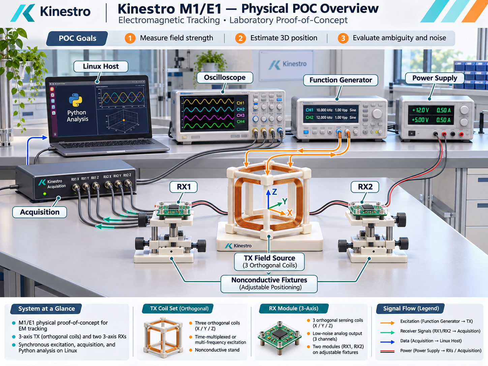
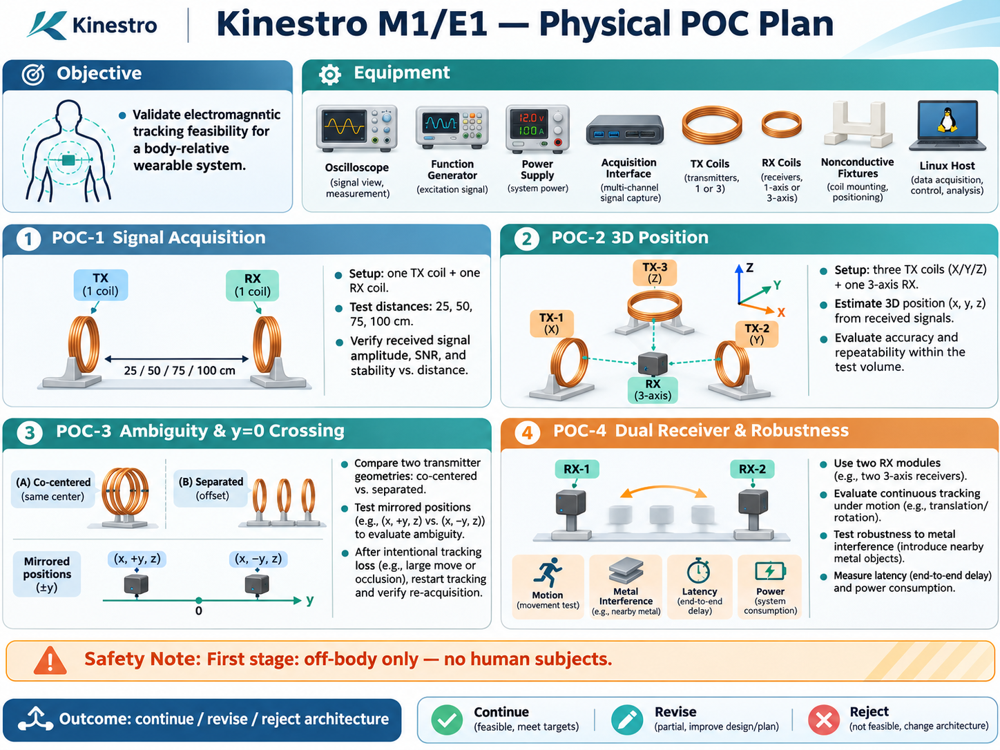
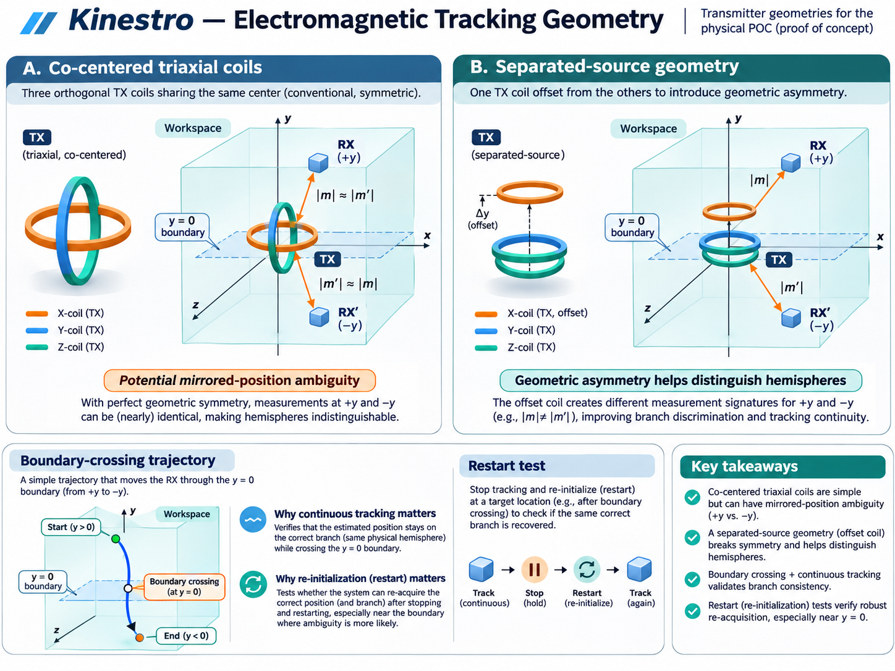

<!--
SPDX-FileCopyrightText: 2026 Vladyslav Kononiuk
SPDX-License-Identifier: CC-BY-4.0
-->

# M1/E1 physical proof of concept

**Research outline, 2026-11-17; no physical validation performed.** This document audits the owner's concept illustrations and preserves the experimental questions for R-01/E1, U-01/U-04/U-05 and N-03. It does not close E1 or approve a wearable architecture. Kinestro remains the Wearable Spatial Input System implementing Cyberdirigokinesis.

| Research document | Purpose |
| --- | --- |
| [Bench validation plan](../bench-validation-plan.md) | Required measurement capabilities, calibration, uncertainty, protocols and safety review |
| [Power and signal analysis](../power-feasibility.md) | Explicit theoretical winding, voltage, receiver-noise and energy assumptions |
| [Simulation results](../simulation-results.md) | Numerical evidence and limitations, including hemisphere and restart failures |

## Experimental stages

| Stage | Research question |
| --- | --- |
| POC-1 — Single-axis signal acquisition | Are signed, current-referenced receiver signals observable across the declared distances, with characterized noise, feedthrough and drift? One TX/RX axis does not establish 3D position. |
| POC-2 — Static 3D pose | Do calibrated TX/RX triads provide useful local pose information on independently held-out targets, with known winding geometry and channel transfer? Report global ambiguity separately. |
| POC-3 — Ambiguity and boundary crossing | Compare true antipodes, Y-only reflections, crossings in both directions, unknown-state restart and a spatially offset source. Smoothness and low residuals do not establish the absolute branch. |
| POC-4 — Dual receivers and robustness | Test both independently moving receivers, loading/cross-talk, conductive and ferromagnetic perturbations, timing, power and thermal behavior. |

Use wound air-core coils, measured source currents and calibrated signed receiver observations as an experimental hypothesis. Begin off-body with static sequential excitation and characterized inactive-winding conditions. Continuous excitation requires independently qualified separation, timing, settling, gain/phase and current-mixing behavior. Preserve the existing distinction between literature, simulation and physical measurements; no apparatus capability is established by the artwork.

## Concept-art audit

The three illustrations were generated using OpenAI image-generation tools at the project owner's request. The owner makes them available under [CC-BY-4.0](../../../LICENSES/CC-BY-4.0.txt) to the extent applicable rights are held by the owner. This designation does not assert that the illustrations necessarily qualify for copyright protection in every jurisdiction. They are conceptual visual references, not validated engineering drawings, existing inventory or evidence. Unmodified copies are stored in [references/](references/). See the [licensing policy](../../../LICENSE.md#external-materials-data-and-branding) for third-party and trademark boundaries.

### Supplied visual references — AI-generated, not validated engineering

**Laboratory overview:** the driver, acquisition and fixture corrections in the audit below take precedence over the illustration.

**Physical POC plan:** the research stages and validation protocols define the experiment.

**Tracking geometry:** the illustrated Y-only reflections are not general antipodal pairs; use the corrected coordinates and source geometry below.

### Engineering audit

| Reference / feature | Assessment | Required engineering treatment |
| --- | --- | --- |
| Lab overview: laptop, generator, scope, source, two RX fixtures | Feasible experimental arrangement | Move metal instruments and electronics away from the mapped volume; prove clearance by perturbation tests. Establish the actual configuration independently of the pictured inventory. |
| Generator wired directly to TX | Requires modification | Three independent current-monitored power stages; generator outputs are low-level commands. Include ballast, shunts, fuses, clamps and a physical stop. |
| Two generator channels driving a three-axis source | Insufficient as illustrated | Three simultaneous identified carriers require three independent excitation paths. Static operation uses one channel and disconnected inactive coils. |
| Four-channel scope plus six-input acquisition box | Requires modification | Scope is diagnostic. Qualify acquisition timing and channel alignment; six RX voltages plus three current signals require at least nine analog channels. |
| Flat, unidentified RX PCBs and acquisition enclosure | Cannot yet be justified | No available sensor or suitable circuit can be inferred. Specify six wound sensing axes and real amplifier boards, with independently characterized electrical transfer and calibration. |
| Orthogonal TX triad | Feasible with measured winding geometry | A coil's axis is normal to its plane: X in YZ, Y in ZX, Z in XY. Drawings showing three parallel rings do not represent an orthogonal triad. |
| White feet with metal micrometer stages, screws and table | Requires modification | Specify polymer/wood fixtures, polymer fasteners and a support whose electromagnetic influence is characterized; identify hidden metal and measure its influence. |
| Plan: one-axis signal, pose, ambiguity, dual RX stages | Feasible staged questions | Separate the research questions and entry/exit evidence for each stage. Static signal detection alone does not establish 3D pose. |
| Plan/geometry: `(x,+y,z)` and `(x,-y,z)` called antipodes | Physically incorrect in general | Antipodes are `(x,y,z)` and `(-x,-y,-z)` at the same attitude. Test y-only reflection separately. |
| Geometry: offset source / different magnitudes | Plausible research hypothesis | Use the existing diagnostic: **X-directed coil moved +0.120 m in X**. Preserve its YZ plane. Compare full signed complex measurements and competing fitted poses; unequal magnitudes alone are not a uniqueness proof. |
| Continuous path “validates the physical hemisphere” | Cannot be justified | A wrong branch can remain smooth. Cross y=0 in both directions and test blind restart; retain both co-centered hypotheses. |
| “Occlusion” causes EM tracking loss | Requires modification | Test range loss, data interruption, saturation and known conductive/ferromagnetic perturbations. Ordinary optical blockage is not a general magnetic line-of-sight failure. |
| On-body feasibility, low latency, power/runtime implied by artwork | Unproven | First phase is entirely off-body; quantify measurement age and bench power. Wearable mass, exposure, battery efficiency and radio remain later questions. |

## Correct geometry and interpretation

Use the existing right-handed body-reference convention **+X right, +Y forward, +Z up**, translated onto the off-body fixture. Source centers are `s_X=s_Y=s_Z=(0,0,0)` for the ideal co-centered model. Actual finite winding packs require measured centers/axes rather than an assertion of perfect coincidence.

For a centered dipole,

`B(r,m) = μ0/(4π|r|³) [3 n(n·m) − m]`, so **`Y(r,R)=Y(-r,R)`** for the full signed triad at the same RX attitude R. Centered circular loops also retain this inversion symmetry. Moving only Y is a plane reflection, not inversion. Example: `(0.25,0.05,0.15)` has antipode `(-0.25,-0.05,-0.15)`; `(0.25,-0.05,0.15)` is a different test. Neither target lies at the source.

For the separated comparison, set `s_X=(0.120,0,0)` and `s_Y=s_Z=(0,0,0)`; evaluate `B(r-s_j,m_j)` for each winding. This removes the common inversion identity but does not prove global injectivity or reliable branch selection. Unintended manufacturing offsets in the baseline are nuisance parameters, not a validated ambiguity solution.

`m` denotes magnetic moment in A m², `B` field in tesla, `I` measured winding current in amperes, and `Y` calibrated signed coupling/field observations. Do not reuse `|m|` as a position or measurement label. **y=0 is an initializer convention, not a physical field discontinuity or inherent local-rank singularity** away from the source. See the existing [boundary results](../simulation-results.md#boundary-and-hemisphere-validation-boundary-v1).

## Validation status

The illustrations are visual references and the stages above are research proposals. Before measurements, establish the actual electrical limits, current paths, winding geometry, calibration, synchronization, noise, metrology uncertainty and safety controls under the [bench validation plan](../bench-validation-plan.md). Evaluate the declared workspace, failures and branch reliability independently. No measured accuracy, latency, runtime, exposure compliance or final component choice is claimed.
