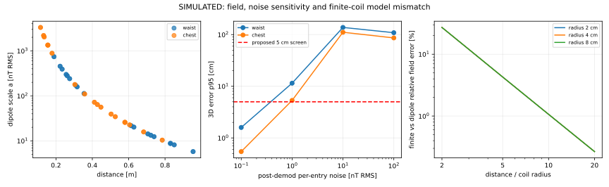
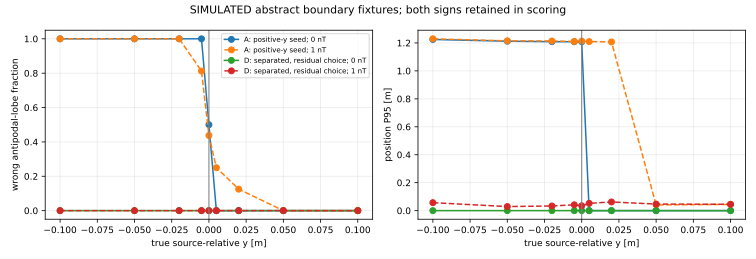
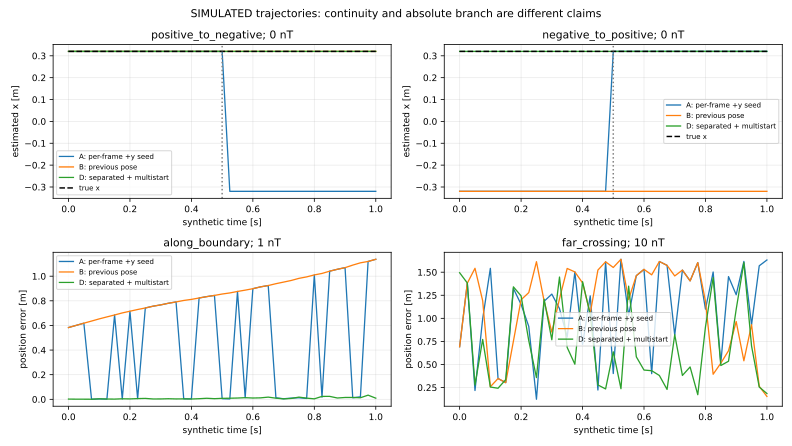

<!--
SPDX-FileCopyrightText: 2026 Vladyslav Kononiuk
SPDX-License-Identifier: CC-BY-4.0
-->

# Synthetic simulation results

**Evidence class: SIMULATED throughout. No physical measurements were performed.** These are conditional results for the source, geometry, calibration, noise and branch assumptions below, not a sensor specification or validated Kinestro performance. See [reproduction instructions](README.md#reproduce), the [model/derivation](feasibility-report.md), and the machine-readable [summary](results/summary.json).

The original results below are the **72-point positive-y baseline from commit `6ac8d9e`**, retained unchanged for comparability. They do not validate that y stays positive in Kinestro. The separate [boundary/hemisphere extension](#boundary-and-hemisphere-validation-boundary-v1) evaluates that missing condition without altering the anatomical assumptions or correcting signs using truth.

## Method, parameters, and denominators

The committed run uses seed **20261115**, CPython 3.14.7, NumPy 2.5.4, SciPy 1.18.1, and Matplotlib 3.11.2. Source-module SHA-256 hashes are recorded in the JSON. It evaluates **4,320 primary pose fits**, plus 24 random-initialization fits and specific ambiguity diagnostics. No observed failures are removed before computing error distributions.

| Input | Value and convention |
| --- | --- |
| Baseline source | Three co-centered orthogonal identified states; each moment $m=100\pi(0.04)^2(0.1)=0.0502655$ A·m² RMS |
| Field and receiver | Free-space dipole; 3 signed calibrated RX axes; local-to-reference rotation $R$; observation $R^TB$ |
| Workspace | 72 points: 3 assumed size scales × 6 paired arm configurations × 2 hands × 2 source placements; see [geometry](e1/geometry.py) and [full target CSV](results/workspace.csv) |
| Coordinate frame | Waist origin, +x right, +y forward, +z up; source-relative positions in metres; orientation perturbations in radians |
| Noise | Independent zero-mean Gaussian per signed matrix entry, post-demodulation field-equivalent RMS: 0, 0.1, 1, 10, 100 nT; no measured bandwidth/spectrum implied |
| Monte Carlo | 6 independent noise/random-roll trials per point per noise level: 432 fits/level; 216 per mount; each body-scale/mount stratum has 72 |
| Roll | Uniform local RX roll in $[-\pi,\pi]$; full-triad rotational norm invariance is checked separately |
| Initialization | Analytic seed from the observation only, choosing positive reference y; this is an explicit hemisphere prior. No truth-seeded Monte Carlo fits |
| Inverse | SciPy bounded trust-region-reflective least squares (`trf`); ±2 m numerical position box, unrestricted rotation-vector parameters, 180 maximum evaluations, 1 nT residual scaling; tolerances $10^{-10}$ |
| Model mismatch | Finite TX loops, gains, nonorthogonality, source offset and sequential motion described below; the inverse remains an ideal point dipole |
| Statistics | Euclidean receiver-center position error; geodesic SO(3) attitude error; median/P95/worst, optimizer status, ≤5 cm fraction, and wrong-lobe fraction |

The positive-y restriction is only used to choose the seed, not imposed as a solver bound. `antipodal_lobe_fraction` counts $\hat{\mathbf p}\cdot\mathbf p_{true}<0$, a **truth-dependent offline diagnostic**, not a runtime confidence test. A separate negative-y fraction tests the stated hemisphere. Noise can select a mirror-like lobe near the y=0 boundary even while the estimated y remains positive. Local fit residual and solver status cannot reliably detect this.

The [official SciPy least-squares documentation](https://docs.scipy.org/doc/scipy/reference/generated/scipy.optimize.least_squares.html) describes the bounded local solver and its termination criteria. We explicitly select `trf`; a returned success flag establishes numerical termination, not global uniqueness.

The equal-moment analytic initializer is evaluated against independent random noise, independent receiver roll, and finite/corrupted forward observations. There is no fitted calibration dataset or parameter tuning on the evaluation targets. This is stronger than noiseless self-inversion, but still a simulation with known calibration conventions. It is not population-level validation.

Reported evaluation counts are SciPy's `nfev`, which excludes calls used for numerical Jacobian estimation. They are not wall-clock latency, sensor acquisition counts, or an achieved update rate.

## Workspace and signals

| Mount | Distance range | Minimum dipole scale $a$ | Important limitation |
| --- | --- | --- | --- |
| Waist | 0.1893–0.9544 m | 5.78 nT RMS | Lateral/extended arms create weak, branch-sensitive observations |
| Chest | 0.1149–0.7847 m | 10.40 nT RMS | Shorter worst-case distance, but closest positions challenge finite-coil approximation and dynamic range |

Here $a=\mu_0m/(4\pi r^3)$; the full matrix norm is $\sqrt6a$. Individual projected channels can approach zero. With all calibrated axes and isotropic noise, a rigid RX rotation changes those entries but not the norm or ideal local information. The receiver remains a point sample, not a finite-area pickup.

Both hands include rest, raised, forward, lateral, near-torso and crossed poses. These are assumed static configurations, not measured walking/seated kinematics. All 72 nominal targets are evaluated; the ≤5 cm fraction describes sampled **attempts**, not continuous workspace volume or a guarantee between points. Anatomical wrist/hand offsets, skin/mount slip and fine wrist movement are not measured by this model.

## Noise sweep

Each row pools 432 attempts. Noiseless inversion recovers the declared branch to numerical precision; it is a consistency test, not a performance result.

| Noise [nT RMS/entry] | Pooled median [cm] | Pooled P95 [cm] | Waist P95 [cm] | Chest P95 [cm] | Attempts ≤5 cm | Antipodal lobe |
| --- | --- | --- | --- | --- | --- | --- |
| 0.1 | 0.044 | 1.18 | 1.59 | 0.54 | 100% | 0% |
| 1 | 0.457 | 10.21 | 11.48 | 5.32 | 82.64% | 1.16% |
| 10 | 5.01 | 127.24 | 137.65 | 111.05 | 50.00% | 12.04% |
| 100 | 35.32 | 102.80 | 108.81 | 86.27 | 24.07% | 20.60% |

**All these optimizers reported success.** Numerical termination therefore fails as a proxy for the proposed accuracy screen. The 10/100 nT results are severely nonlinear, with spurious solutions and branch errors; the nonmonotone P95 at extreme noise does not mean that adding noise improves tracking. P95 attitude error rises from approximately 1.67° at 0.1 nT to 14.64°, 146.37° and 172.16° at the higher levels. Worst errors, residuals, and counts are retained in the JSON.

At 1 nT, P95 for assumed body scales 0.85/1/1.15 is **7.04/10.42/18.77 cm at waist** and **2.80/4.39/13.04 cm at chest**. Different ranges and rare wrong-lobe fits affect these pooled body-size results. They are not evidence of a demographic effect. [Body-size](results/body_size_summary.csv), [pose](results/pose_summary.csv), and [distance](results/distance_summary.csv) tables retain their individual denominators. The farthest chest bin has only 12 trials and a 25% wrong-lobe fraction: its P95 is particularly unstable.

The three finite-model curves overlap when plotted against distance/radius: at fixed moment the dimensionless thin-loop approximation error depends on that ratio, not the absolute radius. This is a model-scaling result, not three independent physical measurements.

## Forward-model and calibration mismatch

The following scenarios each use 72 targets, one random RX roll per target, and **zero added random measurement noise** to isolate their effects. These are synthetic sensitivity scenarios, not estimates of manufacturing tolerance or real metal distortion.

| Perturbation applied only in forward model | Pooled position P95 [cm] | P95 attitude error [degrees] |
| --- | --- | --- |
| Common TX gain +1% / +5% / +10% | 0.28 / 1.35 / 2.62 | approximately zero |
| First TX moment rotated 2° about reference z | 2.22 | 3.35 |
| RX gains [1.03, 0.97, 1] | 1.83 | 4.72 |
| First RX axis tilted 2° toward local second axis | 1.12 | 3.42 |
| Rigid RX-frame rotation 2° | numerical position precision | 2.00 |
| First source center shifted +5 mm in reference x | 0.94 | 4.75 |
| Sequential states span 10 ms, +y translation at 1 m/s | 1.72 | 11.71 |
| Finite transmitter radius 2 / 4 / 8 cm, same moment | 0.42 / 1.66 / 6.74 | 2.72 / 10.61 / 40.62 |

Common gain is an undetectable range-scale bias in the ideal model, with near-zero fitting residual. A rigid RX rotation is absorbed into estimated attitude and does not imitate nonorthogonality. Finite transmitter geometry is significant for the closest chest targets; increasing radius at fixed moment changes geometry and winding requirements together, not free signal gain. The exact axes, signs and perturbations are in [run.py](e1/run.py); finite-field quadrature accuracy is tested independently from dipole mismatch.

Two moment sweeps with the **correct moment supplied to the inverse** use 432 noisy trials each at 1 nT. Halving the moment yields pooled P95 **57.11 cm** with **4.63%** wrong-lobe fits; doubling it yields **5.98 cm** with **0.46%** wrong-lobe fits. These use different random draws and do not establish a precise current threshold or monotone probabilistic guarantee. Stronger excitation cannot resolve the exact co-centered symmetry or systematic field distortion.

A combined held-out sensitivity case uses finite 4 cm transmitter loops, common gain +5%, RX gains [1.03, 0.97, 1], and 1 nT random noise. Across 432 attempts its pooled median/P95 is **1.73/12.59 cm**, and **2.08%** of estimates are on the opposite lobe. Separate favorable single-error scenarios are therefore insufficient to claim the target.

## Observability, ambiguity, and initialization failures

Numerical rank uses relative singular-value threshold $10^{-7}$; derivatives use centered $10^{-5}$ perturbations of 1 m translation and 1 rad **local** rotation coordinates. Finite-difference roundoff is not interpreted as a new observable state. Among the 72 nominal geometries, one RX axis has rank 3, two axes happen to have rank 6, and full triads have rank 6. Two-axis condition numbers span approximately 22–769 under the declared scaling, versus 12–91 for full triads. These dimensioned/scaled comparisons are not direct error estimates.

The deliberate aligned radial-z diagnostic has **rank 4 with two RX axes** and **rank 6 with three**. Thus the absence of singular points in a sparse anatomical sample would not justify saying six channels always recover six DoF. Ideal local covariance for the full triad matches the independent analytical diagonal $(5/9,5/9,1/54)(\sigma_B r/a)^2$, but that calculation omits all global branch errors and bias.

At test position (0.22, 0.43, 0.17) m, the ideal antipodal observation difference is zero. Fitting from the mirrored initialization yields **1.024 m position error** with approximately $1.7\times10^{-14}$ nT RMS residual. Centered finite loops preserve the symmetry to quadrature precision. Across 24 arbitrary noiseless initializations, 24 optimizers terminate successfully; 12 recover the intended position within 5 cm and 24 reach one of the two antipodal positions within 5 cm. These are explicit alternative solutions, not noise or unexplained implementation failures.

Moving one source center +0.12 m in x produces a nonzero approximately **43.39 nT** same-attitude mirror difference at this one pose. With the displaced observations themselves supplying the approximate analytic seed, the positive start recovers the pose. The negative start still reaches a wrong local minimum approximately **0.920 m** away, with only **1.21 nT** RMS residual after adjusting attitude. This is an **initialization/local-minimum failure** retained as evidence. Breaking one exact symmetry does not prove robust branch discrimination at 1 nT, global uniqueness, or coverage for that layout.

The ideal two-receiver joint Jacobian has rank **12 for 12 pose states** from 18 observations. Adding a common unknown source gain gives 13 states but still rank **12**, consistent with the scale ambiguity. Passive receivers do not interfere in this model by construction; no measured coupling, scheduling, radio or clock behavior is implied.

## Interpretation and limits

The preliminary 5 cm screen is plausible **in favorable synthetic conditions**, including the assumed 0.1 nT regime. It is not robustly met over this assumed workspace at 1 nT, and the actual attainable field noise versus update rate is unknown. Chest placement improves range in the selected body model but also emphasizes close-field model error; no mounting decision follows.

Six noise trials per point and one roll per mismatch point provide screening-level empirical percentiles, not confidence intervals or a reliable extreme-error probability. Results depend on the assumed pose distribution and branch prior. No saturation, colored/coherent interference, source-current fluctuations, thermal drift, receive-coil flux integration, receiver loading, mutual coupling, metal fields, human motion, BLE timing, fusion or display latency is modeled. A scalar field-noise number cannot establish the acquisition time needed to achieve it.

Model equations, limiting cases, calibration variants, branch tests and independent forward-model cases explain the recorded failures; no unexplained solver-status failures occurred in this run. The reference-frame attitude is receiver attitude, not hand articulation. Figures and summaries are small reproducible synthetic report artifacts; raw Monte Carlo draws are regenerated from the seed rather than committed. Use the [off-body bench plan](bench-validation-plan.md) to determine whether the assumptions are physically attainable. E1 remains open.

## Boundary and hemisphere validation (boundary-v1)

**Evidence class: additional synthetic diagnostics, not physical or anatomical validation.** This extension addresses the favorable y>0 condition in the original 72-point study. The old geometry, solver, model and all nine baseline artifacts remain unchanged. Expanded outputs are isolated under [results/boundary-v1](results/boundary-v1/summary.json) and [figures/boundary-v1](figures/boundary-v1/static_boundary.svg).

### Fixtures, protocols and interpretation

The static fixture uses source-relative y offsets **−0.10, −0.05, −0.02, −0.005, 0, +0.005, +0.02, +0.05, +0.10 m**. Four (x,z) points are (0.25,0.15), (−0.25,−0.15), (0.55,−0.25), (−0.55,0.25) m. Each has two RX orientations: identity and XYZ Euler (35°,−25°,70°). Radii are approximately 0.292–0.612 m, away from the point-source singularity. All poses have explicit antipodal partners with the **same** attitude; reflection negates x, y and z together, not y alone.

There are 144 fixture poses: 4 x/z choices × 9 offsets × 2 orientations × 2 mount transforms. Waist origin is (0,0,0); chest is (0,0.04,0.32) m in the same assumed body frame. The relative fixtures deliberately repeat the same free-space problem at each mount. Different noisy results between mount labels are independent draws, **not evidence that one mounting position handles ambiguity better**. [workspace.csv](results/boundary-v1/workspace.csv) records source-relative and body-frame coordinates, orientations, mirror IDs and `abstract_off_body_diagnostic` classification. These are not invented realistic arm poses. The separately preserved anatomical baseline is only anatomically motivated, not measured anthropometry.

Seed **20261116** spawns independent static, random-initialization and trajectory streams. The static sweep uses 0/0.1/1/10 nT independent Gaussian RMS noise per signed matrix entry and two draws per pose/level: **1,152 observation matrices per source model**. The same random perturbation is used for paired co-centered/separated comparisons to control Monte Carlo variation; this is not a claim of correlated noise between physical receivers. Zero-noise repetitions duplicate deterministic fixtures and are not independent evidence.

The existing ±2 m optimizer box, 180-evaluation budget, RMS moment and calibration assumptions are retained. Truth enters only generation and the separate scoring function; it is absent from all estimator/continuation interfaces and selection criteria. No trajectory is initialized from its true pose and no sign is flipped to reduce the scored error. This matters when comparing to local-precision benchmarks: the [2019 reference paper](https://arxiv.org/html/1909.08356v1) explicitly used truth-based sign correction for its simulation RMSE; that correction is **not** used here.

| Strategy | Information actually used |
| --- | --- |
| A — current positive-y initialization | Existing observation-derived analytic seed, independently at every frame/fixture; no y bound during optimization |
| B — previous-pose continuation | First observation initialized with an unverified +y assumption; later observations initialized from the previous estimated pose. No velocity model, continuity penalty, external sign measurement or truth gating |
| C — two hypotheses | Retain B (or A for static tests) and its exact antipodal partner. The second is generated by the model symmetry, not counted as an independent optimizer success. Never choose a member using truth |
| D — separated source | Existing diagnostic geometry: x-directed source at (+0.12,0,0) m, other sources at the origin. Two approximate observation-derived starts for static tests; additionally the previous estimate for trajectories. Select converged candidates then smallest observed residual, never actual pose error |

All errors include failed numerical fits. A wrong branch means $\hat p\cdot p_{true}<0$; this is an offline truth-based metric, not a runtime detector. The low-residual wrong-pose proxy means error >5 cm while residual RMS ≤3 times the imposed noise; at zero noise it uses a numerical 10⁻⁶ nT tolerance. This is **not calibrated confidence**. Exact offsets are reported in [static_offsets.csv](results/boundary-v1/static_offsets.csv), separately from [regional summaries](results/boundary-v1/static_regions.csv).

Only two noise realizations per fixed pose/path are used. Reported fractions and percentiles are descriptive screening results, not population probabilities or confidence bounds; zero observed D branch errors at a noise level does not establish a zero failure probability. This extension isolates hemisphere behavior with known calibrated point-source models. The original finite-geometry, calibration, metal, timing and hardware limitations remain unresolved.

### Static sign and boundary results

The coarse regions are disjoint: negative y<−5 mm, near-zero |y|≤5 mm, positive y>5 mm. Each pooled regional row contains 96 attempted observations per noise level; per-mount rows and all nine exact offsets remain available so difficult signs are not hidden in a single workspace average.

| Zero noise, strategy A | Position P95 | Wrong branch | Optimizer success |
| --- | --- | --- | --- |
| Positive y>5 mm | Numerical precision | 0% | 100% |
| Near zero, abs(y)≤5 mm | 1.208 m | 50% | 100% |
| Negative y<−5 mm | 1.225 m | 100% | 100% |

The same wrong solutions have near-zero residuals. At exact y=0 the analytic eigenvector sign is not determined by the y rule; floating-point sign choices can change between neighboring poses even without imposed noise. This is an initializer discontinuity and a global two-solution ambiguity, not a local field singularity. The full-triad local Jacobian has rank **six at every stress pose**, including y=0. Centered finite-loop antipodal differences remain below approximately $2\times10^{-21}$ T in this fixture sweep.

| At 1 nT | A P95 | A wrong branch | D P95 | D wrong branch |
| --- | --- | --- | --- | --- |
| Positive y>5 mm | 5.96 cm | 4.17% | 5.21 cm | 0% |
| Near zero, abs(y)≤5 mm | 121.13 cm | 47.92% | 4.49 cm | 0% |
| Negative y<−5 mm | 122.63 cm | 97.92% | 5.09 cm | 0% |

D distinguishes the signs on these zero-noise fixtures and is much better at 1 nT, but this is not a uniqueness proof or a validated layout. At 10 nT its regional wrong-branch fractions are approximately **5.21–12.50%**, with P95 errors **0.931–1.201 m**. Both data-derived starting fits and their residual selection are retained; a local minimum or noise can still win. The earlier baseline's displaced-source local-minimum counterexample also remains valid and unchanged.

The separate [random-initialization diagnostic](results/boundary-v1/initializations.csv) uses four random attitudes/directions and observation-derived range scales for a fixed near-boundary subset. Without noise, **23/48** fits reach the wrong branch despite all 48 terminating successfully. At 1 nT, **15/48** fits reach the unchanged 180-evaluation budget without success; those records are retained, with residuals approximately 0.284–1.471 nT and errors ranging from 0.188 mm to 0.583 m. This is an observed numerical budget/initialization limitation, not proof of lost local observability. The precise cause of slow termination is not isolated, and a low residual does not override the failed status.

### Continuous trajectories, initialization and recovery

Six abstract paths per mount use 41 samples at 25 ms spacing (one second), two noise trials and all four noise levels: **3,936 observations per source model**. The time interval is a synthetic sampling assumption, not achieved hardware update rate. Paths cover both crossing directions, motion exactly on the plane, ±2 mm near-plane oscillation, a crossing with changing attitude, and a more distant crossing at x=0.8,z=0.3 m. The first two crossings move y from +0.12 to −0.12 m and vice versa at x=0.32,z=0.18 m. [boundary.py](e1/boundary.py) specifies every trajectory and attitude function.

[trajectory_summary.csv](results/boundary-v1/trajectory_summary.csv) retains every path/mount/noise/trial/strategy separately: error median/P95/max, attitude, residual, convergence, initial branch, subsequent branch loss/transitions, final error, step error and error-time integral. A >20 cm estimated-step marker is a declared diagnostic only, not a safety or product threshold. Actual step magnitudes are reported alongside true step magnitudes. The integral measures tracking error over time; this is not an inertial drift model. [trajectory_traces.csv](results/boundary-v1/trajectory_traces.csv) retains per-frame errors, estimated x, branches and residuals for representative waist runs at 0 and 1 nT; other draws regenerate from the seed.

Noiseless waist examples illustrate the distinction:

| Path | A behavior | B behavior |
| --- | --- | --- |
| Positive → negative y | Approximately 0.734 m estimate jump near the boundary; final error 0.773 m | Correct continuous branch, maximum step 0.006 m |
| Negative → positive y | Starts wrong, switches to the now-positive side; approximately 0.734 m jump | Remains continuously mirrored for the entire path; final error 0.773 m, maximum step 0.006 m |
| Along y=0 | 22 branch transitions; maximum estimate step approximately 1.115 m | Continuous chosen branch; its correctness still depends on the unverified first sign |
| Crossing with changing attitude | Approximately 0.790 m jump | Continuous correct branch for this positive-start fixture |

Changing attitude does not remove the exact symmetry because the mirrored path uses the same $R(t)$. B is a local warm start, not a full motion filter. It can preserve the correct branch when initialized correctly; it can preserve an incorrect branch just as well. At lower SNR its estimates can also jitter or jump. For example, in the waist far-crossing runs at 10 nT, mean wrong-branch fractions are approximately 53.66% for A, 48.78% for B and 30.49% for D. Those are only two noisy runs, not validated probabilities; source asymmetry and temporal starts do not guarantee robustness.

The fixed-index restart diagnostic in [restart_summary.csv](results/boundary-v1/restart_summary.csv) discards state at frame 24 (0.6 s) of the positive-to-negative path and reruns the observation-only initializer. Without noise, every remaining estimate is mirrored and the final error is approximately **0.773 m**, although uninterrupted B had tracked correctly. This tests unknown-state reacquisition independently of uninterrupted continuation. It is a synthetic reset, not measured wireless loss or recovery. The accompanying [trajectory hypothesis sets](results/boundary-v1/trajectory_hypotheses.csv) keep both antipodal continuations unresolved rather than relabelling a smooth estimate as verified.

The 10 nT far-crossing records also separate branch loss from bad initialization. Both waist B runs start on the correct branch and subsequently lose it; the two chest-labelled runs start wrong. D loses the branch after a correct start in three of the four far-crossing runs. These mount-labelled draws share the same relative geometry; the difference is noise realization, not a mounting advantage. Thus this simple temporal warm start is neither an absolute-sign detector nor a proven low-SNR motion filter.

### What multiple hypotheses can and cannot establish

In every co-centered static pair, residual differences are zero at the reported precision, including noisy observations. Noise cannot distinguish exact symmetry-related solutions because they make the same prediction against the **same noisy data**. C retains two positions; it does not identify which is physically occupied or enumerate a full noisy posterior. `oracle_set_coverage_5cm_fraction` reports whether at least one candidate is within 5 cm using truth **only for evaluation**; it is not deployable accuracy, a branch-selection rule or a posterior probability. At 1 nT this set coverage is approximately 92.71–97.92% across the three static regions; at 10 nT it drops to approximately 50–52.08%. Keeping two branches cannot repair arbitrary local error.

Local precision, absolute ambiguity, trajectory smoothness, branch-selection reliability and numerical convergence are therefore separate outputs. The JSON's wrong-fit example has **0.592 m actual error**, near-zero residual, rank six and a **1.62 mm conditional local position RMS bound at 1 nT**. That bound ignores the other exact global solution and must not be interpreted as absolute position confidence.

### Implication for Kinestro and physical validation

**Kinestro cannot rely on an unverified positive-y initialization plus a single co-centered source for unrestricted two-arm tracking.** A restricted workspace might support a validated hemisphere prior, and an independently known initial branch plus continuity can support local tracking. Neither condition is established by the old 72-point sample. Receivers near the sides of the body, retracted/resting arm movement, source placement/orientation changes and unknown-state reacquisition must be considered before claiming that y stays positive; these are possible failure modes requiring kinematic/bench validation, not new anatomical measurements.

Prioritize a spatially separated source comparison in the off-body plan, with deliberate sign crossings, low-SNR regions, initialization variation and repeated calibration. The tested one-source displacement supplies useful information but is not selected as the final geometry. Other independently justified positional information or a verified initialization/kinematic constraint may supply the missing sign. Orientation alone cannot distinguish identical-attitude antipodal states; left/right device labels do not establish position, especially with crossed arms. This extension implements no new sensor fusion or hardware and makes no physical safety claim. E1 remains open.
